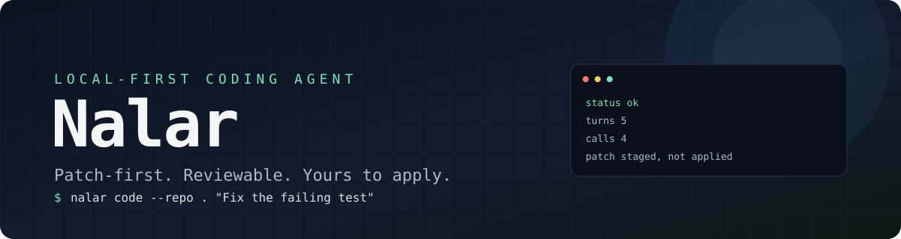
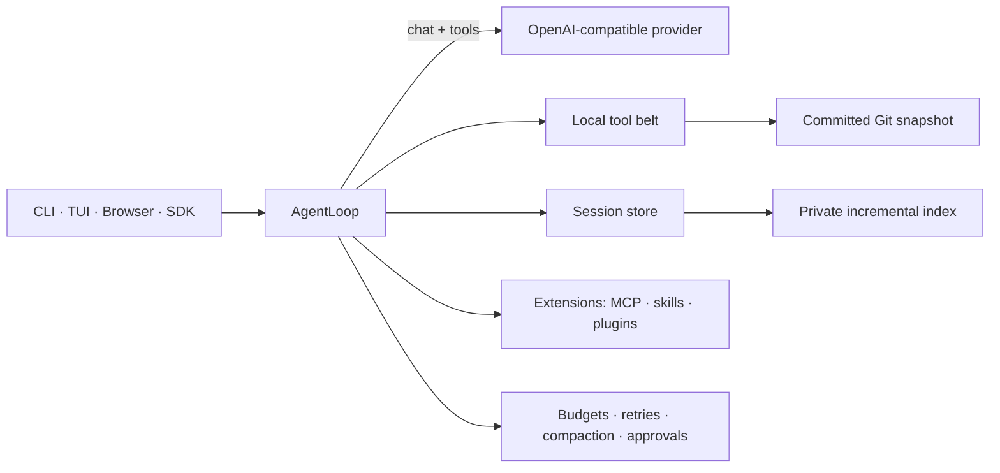

<p align="center">
  
</p>

<p align="center">
  <a href="https://github.com/hamskillah/nalar-agent/actions/workflows/check.yml"></a>
  <a href="https://github.com/hamskillah/nalar-agent/actions/workflows/compat.yml"></a>
  
  
  <a href="LICENSE"></a>
  
</p>

# Nalar

Nalar is a local-first coding agent for people who want to **read the patch
before it lands**. It works on a committed Git snapshot, proposes a reviewable
diff, and never applies or commits it for you. Tools run on your machine; the
model call is BYOK through any OpenAI-compatible endpoint.

It is not a chat wrapper around `git apply`. The runtime is built for recovery:
bounded turns/calls/tokens, retries, cancellation, context compaction, parallel
read tools, repair loops, subagents, approvals, and a private session store.

## Why Nalar

- **Patch-first, not auto-apply.** The original checkout, staged files and
  untracked files stay untouched. Review with `git apply --check`, then apply.
- **Local tools, your provider.** Read/search/git tools execute locally. The key
  comes from an environment variable and is never stored in transcripts.
- **Recovery is a first-class path.** Failed tools, empty/truncated replies,
  verification failures and review findings feed back into bounded repair
  attempts instead of silently “succeeding”.
- **Extensible by design.** MCP clients, skills, prompt commands, trusted
  plugins, a read-only MCP server, a browser workspace and a Python SDK.
- **Useful evidence.** Private session transcripts, token accounting per model,
  a provider wire matrix, a local compatibility smoke and CI on Linux, macOS and
  Windows.
- **Safety gates where they matter.** Credential scanning before apply, trust
  gates for project config, symlink-safe records, a per-worktree apply lock and
  explicit confirmation for verification commands.

## A real run

```console
$ nalar code --repo . --model beam-free \
    'Change answer = 41 to answer = 42 in app.py'

base 99da17171dcf  ·  beam-free
ok · 5 turns · 4 calls · 6237 tokens
diff --git a/app.py b/app.py
--- a/app.py
+++ b/app.py
@@ -1 +1 @@
-answer = 41
+answer = 42
```

The patch is output for review. `app.py` is unchanged until **you** run
`nalar apply` or `git apply`. Exit code `0` means a patch was produced, not that
tests passed.

## Quickstart

```bash
python3 -m venv .venv && . .venv/bin/activate
python -m pip install .

cd /path/to/a/git/repo
nalar init --model <model-id> --detect       # writes bounded verify commands
read -rs -p 'Provider API key: ' NALAR_API_KEY; printf '\n'
# defaults to a local OpenAI-compatible server at 127.0.0.1:11434; override:
# nalar config set provider.base_url https://gateway.example/v1/chat/completions'
export NALAR_API_KEY

nalar tui                                   # interactive workspace
nalar code "Fix the failing test"           # propose a patch
nalar ask "How does authentication work?"   # read-only answer
nalar scan                                  # credential scan, no model
```

Any OpenAI-compatible endpoint works:

```json
{
  "model": "vendor/model",
  "provider": {
    "base_url": "https://gateway.example/v1/chat/completions",
    "api_key_env": "GATEWAY_API_KEY"
  }
}
```

See [providers](docs/providers.md) for headers, base URLs, fallbacks and
timeouts.

## What it can do

| Area | Capability |
| --- | --- |
| Coding | list/search/read, find symbol, repo map, git history, replace, multi-file patches, create/delete/rename/chmod, staged diff |
| Review | review a worktree, staged changes, branch, saved patch or stdin; text/JSON/Markdown/GitHub/SARIF; separate reviewer model |
| Repair | `fix` verifies a snapshot and proposes a corrected patch; bounded attempts, guidance and context; never auto-applies |
| Plan/Ask | read-only modes with plan output and optional private recording |
| Security | credential scan for diffs/tree, explicit override, secret-scrubbed verification, trust gates |
| Sessions | private transcripts, search, stats, export, fork, prune, incremental index, per-model token totals |
| Extensions | MCP stdio/HTTP clients, skills, prompt commands, trusted plugins, read-only MCP server |
| Interfaces | CLI, Textual TUI, browser workspace, Python SDK (`Agent`, `WorkspaceAgent`) |
| Runtime | budgets, retries with `Retry-After`, cancellation, context compaction, parallel reads, subagents, approvals, NDJSON events |

## How the runtime fits together



The loop never gives the model shell access. Tools are typed operations over a
snapshot; repository text is untrusted data. More detail:
[runtime](docs/runtime.md) · [architecture](docs/architecture.md).

## Safety model

- **No auto-apply and no commits.** Applying is an explicit command with
  `--check`, base validation, a clean-tree check and a credential gate.
- **Project config cannot grant privilege.** `provider`, `mcp` and `plugins`
  need `--trust-project`; `permission: auto` is user-config only.
- **Secrets stay out of records.** Keys are read from the environment; session
  files are `0600` in a `0700` directory; scans print kinds and paths, never
  values.
- **Verification is explicit.** `verify`, `apply --verify` and `/verify` run
  configured commands only after approval; coding turns never execute repo code.
- **Bounded by default.** Turn/call/token budgets, diff/context/file caps,
  timeout-bounded verification and a per-worktree apply lock.

Read [security](docs/security.md) before pointing Nalar at a private repository. Use `nalar --help` for the full command reference.

## Documentation

| Start here | Deep dives |
| --- | --- |
| [Architecture](docs/architecture.md) | [Runtime](docs/runtime.md) · [Security](docs/security.md) |
| [Providers and BYOK](docs/providers.md) | [Security](docs/security.md) · [MCP server](docs/mcp-server.md) |
| [Extensions](docs/extensions.md) | [Browser workspace](docs/browser.md) · [MCP server](docs/mcp-server.md) |
| [Provider matrix](docs/provider-matrix.md) | [Benchmarks](docs/benchmark.md) · [Compatibility](docs/compatibility.md) |
| [Release status](docs/status.md) | [Changelog](CHANGELOG.md) · [Compatibility](docs/compatibility.md) |

## Development

```bash
python -m unittest discover -s tests -v        # 1006 tests
ruff check --select E9,F63,F7,F82,F601 nalar tests
scripts/release-check.sh                        # tests, lint, wheel, matrix
python scripts/compat-smoke.py                  # Linux/macOS/Windows smoke
```

CI runs the full suite on Linux 3.12/3.13 and the compatibility smoke on
Ubuntu/macOS/Windows 3.12/3.13. See [CONTRIBUTING.md](CONTRIBUTING.md).

## Status

Current release: **0.7.281**. Linux is fully verified; macOS/Windows and Python
3.13 run the compatibility smoke in CI. Paid smoke is limited to the default
provider; cross-provider behavior is not claimed. See [status](docs/status.md).

Apache-2.0. Nalar is self-hosted and BYOK: you choose and pay your provider.
